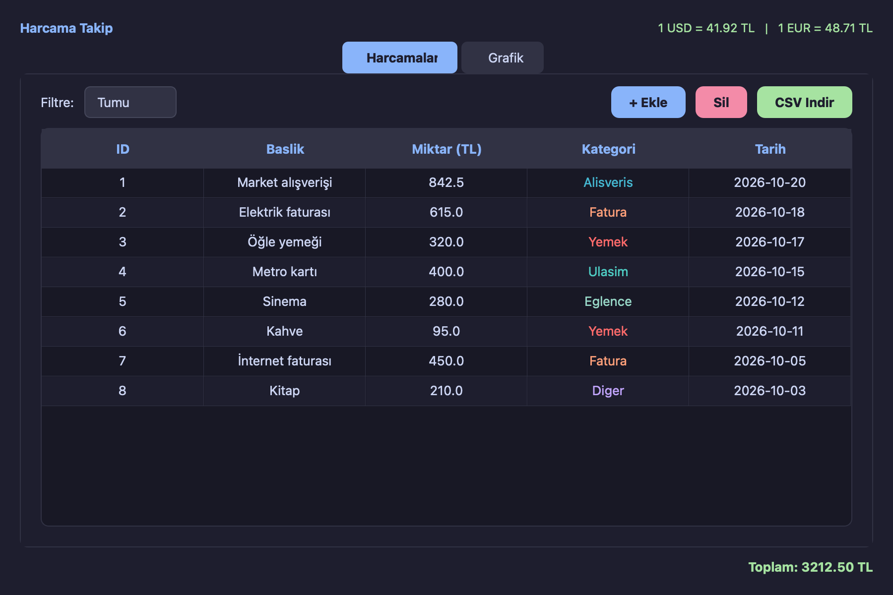
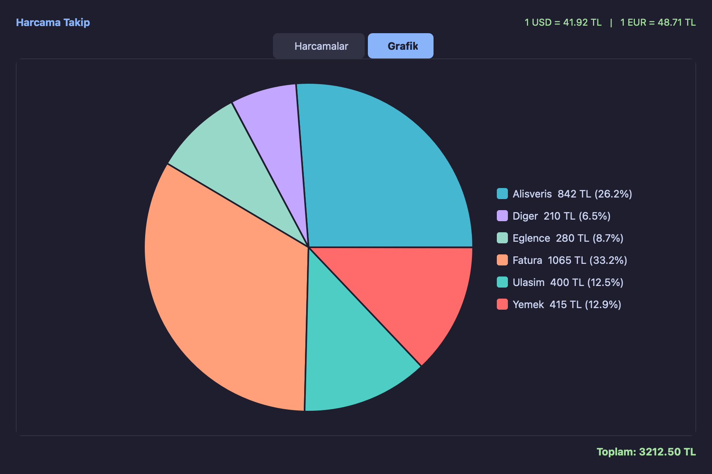

# 💸 Harcama Takip

[](https://github.com/kaanyildiz14/harcama-takip/actions/workflows/test.yml)


Günlük harcamalarını kategorilere ayırarak kaydedebileceğin, grafikle analiz edebileceğin ve CSV olarak dışa aktarabileceğin bir masaüstü uygulaması. Güncel USD/EUR kurlarını canlı olarak gösterir.

| Harcama listesi | Kategori grafiği |
|---|---|
|  |  |

## ✨ Özellikler

- **Harcama yönetimi:** Başlık, tutar, kategori ve tarih ile harcama ekleme/silme
- **Filtreleme:** Kategoriye göre listeleme ve anlık toplam hesaplama
- **Pasta grafik:** `QPainter` ile sıfırdan çizilmiş, kategori dağılımını gösteren grafik
- **CSV dışa aktarma:** Excel ile uyumlu (UTF-8 BOM) CSV çıktısı
- **Canlı döviz kuru:** [ExchangeRate API](https://www.exchangerate-api.com/) üzerinden USD/EUR → TL
- **Kalıcı veri:** SQLite ile yerel veritabanı, parametreli sorgularla SQL injection'a karşı güvenli

## 🛠️ Teknolojiler

| Katman | Teknoloji |
|---|---|
| Arayüz | PyQt5 (özel koyu tema, QSS) |
| Veritabanı | SQLite3 |
| Harici API | REST (`requests`) |
| Test | pytest + GitHub Actions |

## 🚀 Kurulum

```bash
git clone https://github.com/kaanyildiz14/harcama-takip.git
cd harcama-takip
python -m venv venv
source venv/bin/activate        # Windows: venv\Scripts\activate
pip install -r requirements.txt
python main.py
```

Veritabanı dosyası (`harcamalar.db`) ilk çalıştırmada otomatik oluşturulur. Farklı bir konum kullanmak için `HARCAMA_DB` ortam değişkenini ayarlayabilirsin.

## 🧪 Testler

```bash
pip install -r requirements-dev.txt
pytest -v
```

Veritabanı katmanı her test için geçici bir SQLite dosyasıyla, döviz API'si ise mock ile test edilir.

## 📁 Proje Yapısı

```
harcama-takip/
├── main.py              # Uygulama giriş noktası
├── database.py          # SQLite CRUD işlemleri
├── api.py               # Döviz kuru servisi
├── ui/
│   ├── main_window.py   # Ana pencere, tablo ve pasta grafik
│   └── add_expense.py   # Harcama ekleme formu (doğrulamalı)
└── tests/               # pytest testleri
```

## 🗺️ Yol Haritası

- [ ] Harcama düzenleme
- [ ] Aylık bütçe limiti ve uyarılar
- [ ] Tarih aralığına göre filtreleme
- [ ] Aylık trend grafiği

## 📄 Lisans

[MIT](LICENSE)
